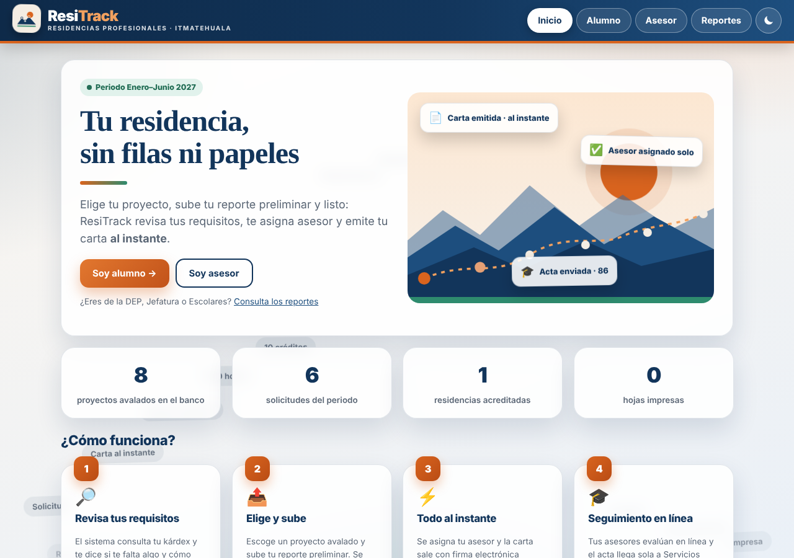
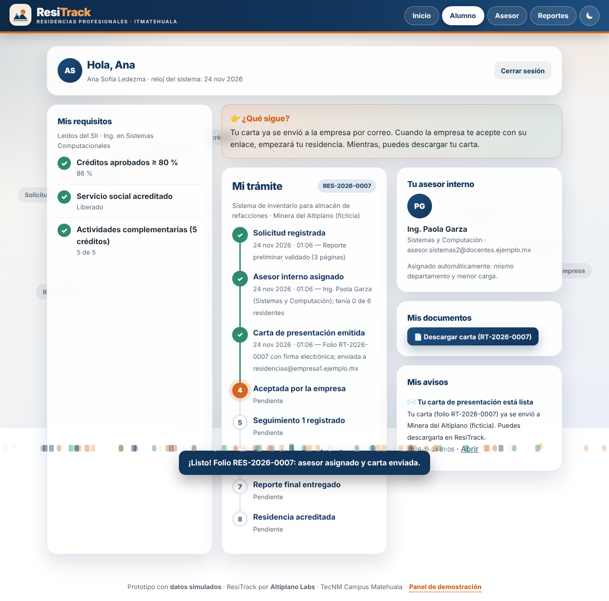
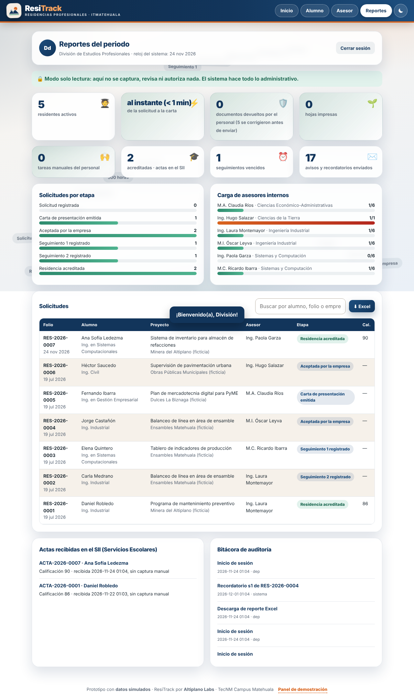

# ResiTrack · Residencias Profesionales sin filas ni papeles

Prototipo funcional de **Altiplano Labs** para automatizar el trámite de **Residencias Profesionales** del TecNM Campus Matehuala.
Hecho con **Python (Flask) + SQLite** y una interfaz web en HTML, CSS y JavaScript.

> ⚠️ **Prototipo académico con datos simulados.** Todos los alumnos, números de control, empresas, asesores y calificaciones son inventados. Las cartas y actas que genera no tienen validez oficial.

## La idea: automatización total
Ya automatizado, **¿quién interviene?** Nadie del personal. El alumno, la empresa y los asesores hacen su parte en línea, y el sistema hace todo lo administrativo. La DEP, la Jefatura y Servicios Escolares **solo consultan reportes**.

| Lo hacía el personal a mano | Lo hace ResiTrack |
|---|---|
| Revisar kárdex y constancias | Verifica los requisitos con el SII (simulado): 80 % de créditos, servicio social y actividades complementarias |
| Revisar el formato del reporte preliminar y devolverlo | Valida el PDF **antes** de enviarlo: secciones obligatorias y hoja membretada solo en la portada |
| Asignar asesor por oficio | Lo asigna solo: mismo departamento, menor carga y sin pasar el tope |
| Hacer la carta y recabar firmas | La emite al instante con folio, firma electrónica y código QR verificable |
| Recibir la carta de aceptación impresa | La empresa acepta con un enlace seguro, sin crear cuenta |
| Formatos de seguimiento impresos y sellados | Los asesores interno y externo evalúan en línea (Anexo XXIX) |
| Capturar la calificación y enviar el acta | Calcula 10 % + 10 % + 80 % y envía el acta al SII (simulado) |
| Avisar fechas | Avisos en cada etapa y recordatorios 3 días antes de cada fecha límite |

## Cómo correrlo en tu computadora

### Opción fácil (Windows)
1. Instala **Python 3.10 o más nuevo** desde https://www.python.org/downloads/ y **marca la casilla «Add python.exe to PATH»**.
2. Descomprime la carpeta y da **doble clic en `iniciar_windows.bat`**.
3. La primera vez tarda un poco porque instala lo necesario. Después se abre solo en **http://localhost:5000**.
4. Para detenerlo, cierra la ventana negra.

En Mac o Linux: `./iniciar_mac_linux.sh`

### Opción con comandos
```bash
python -m venv .venv
.venv\Scripts\activate          # en Mac/Linux: source .venv/bin/activate
pip install -r requirements.txt
python app.py                   # abre http://localhost:5000
```

## Cuentas de demostración
| Rol | Usuario | Contraseña | Qué verás |
|---|---|---|---|
| Alumno | `22000101` | `Resi-2026` | Cumple requisitos y aún no tiene solicitud: **empieza aquí** |
| Alumno | `22000102` | `Resi-2026` | Le falta 1 crédito complementario |
| Alumno | `22000103` | `Resi-2026` | Ya puede subir su reporte final |
| Alumno | `22000104` | `Resi-2026` | Residencia acreditada (descarga su acta) |
| Asesor interno | `asesor.sistemas2` | `Asesor-2026` | Ing. Paola Garza (Sistemas) |
| Asesor interno | `asesor.sistemas` | `Asesor-2026` | M.C. Ricardo Ibarra (tiene un seguimiento vencido) |
| Asesor interno | `asesor.industrial` | `Asesor-2026` | Ing. Laura Montemayor (Industrial) |
| Reportes | `dep` · `jefatura` · `escolares` | `Dep-2026` · `Jefatura-2026` · `Escolares-2026` | Solo lectura |

La **empresa** no tiene cuenta: entra con el enlace que recibe por correo. En el prototipo, esos correos se ven en el **Panel de demostración** (enlace al pie de la página).

## Recorrido sugerido para mostrarlo (5 minutos)
1. **Inicio:** explica la idea y el botón de tema oscuro.
2. **Alumno `22000102`:** el requisito en rojo dice qué falta y cómo resolverlo.
3. **Alumno `22000101`:** elige un proyecto y sube `muestras/reporte_preliminar_sin_cronograma.pdf`. Se rechaza **antes** de enviar. Luego sube `reporte_preliminar_correcto.pdf`. En el mismo instante quedan registrados la solicitud, el asesor y la carta. Descarga la carta y escanea su QR.
4. **Panel de demostración → «Abrir como empresa»:** la empresa acepta y registra a su asesor externo. Pon una fecha de inicio de hace unos 110 días para poder llegar al reporte final en la demostración.
5. **Empresa y asesor `asesor.sistemas2`:** registran los seguimientos 1 y 2; el total se calcula solo.
6. **Alumno:** sube `muestras/reporte_final.pdf`.
7. **Asesor:** evalúa el reporte; el sistema calcula la calificación y envía el acta.
8. **Reportes (`dep`):** indicadores, carga de asesores, actas recibidas y bitácora. **0 tareas manuales, 0 hojas impresas.**
9. **Panel de demostración → «+7 días»:** el reloj avanza y se envían recordatorios automáticos.

## Pruebas automáticas
```bash
pip install -r requirements-dev.txt
python -m pytest -q                       # 9 pruebas de API y reglas de negocio
python -m playwright install chromium
python app.py                             # en otra terminal
python tests/prueba_navegador.py http://localhost:5000 capturas   # 23 pruebas en el navegador + capturas
```

## Estructura
```
app.py              servidor Flask, base de datos, reglas de negocio y PDFs
templates/index.html  página única
static/             estilos (style.css), interfaz (app.js) y logotipo
muestras/           PDF de ejemplo para probar la validación
tests/              pruebas automáticas (pytest y navegador)
tools/              script que genera los PDF de ejemplo
data/               se crea solo: base de datos y archivos subidos (no se sube a GitHub)
```

## Subirlo a GitHub y publicarlo (después)
1. Crea un repositorio en GitHub y sube esta carpeta. El archivo `.gitignore` ya evita subir `data/` y `.venv/`.
2. En https://render.com: **New → Web Service**, conecta el repositorio. Render lee `render.yaml`: build `pip install -r requirements.txt` y start `gunicorn app:app --workers 1 --threads 8`.
3. En el plan gratuito el disco no es permanente: al reiniciarse, la base vuelve a los datos simulados. Para la práctica es suficiente.

## Trazabilidad con el libro del proyecto
Cada pantalla corresponde a un caso de uso (CU-01 a CU-13) y a los requerimientos RF-01 a RF-15 del análisis «ResiTrack», de Altiplano Labs.

## Capturas
| Inicio | Trámite del alumno | Reportes |
|---|---|---|
|  |  |  |
